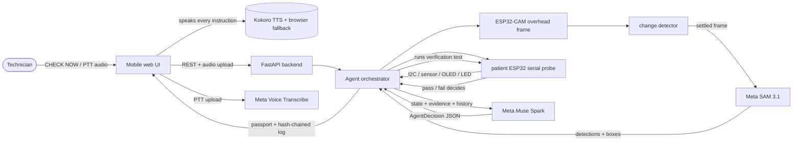

# FundiLoop — verifiable assembly & diagnostic agent for embedded hardware

FundiLoop guides a technician by voice, watches the real circuit with an
overhead camera, verifies every step with real electrical measurements, and
only declares success when a sensor test passes. It is not a chatbot, not a
RAG app, and not a simple image analyzer.

Target circuit (the only one the MVP supports): ESP32 DevKit + BME280 (I2C
0x76/0x77) + SSD1306 OLED (I2C 0x3C) + LED on GPIO 2.

## Repo layout

- `backend/app/` — FastAPI app + orchestrator (`main.py`, `agent_orchestrator.py`,
  `circuit_graph.py`, `serial_probe.py`, `camera_client.py`, `change_detector.py`,
  `models.py`, `adapters/`)
- `backend/data/circuit_esp32_bme280_oled.yaml` — 8 assembly steps, LED wiring, faults
- `backend/requirements.txt` — Python deps
- `firmware/patient_board/patient_board.ino` — patient ESP32 firmware
  (`PING`, `I2C_SCAN`, `READ_SENSOR`, `SELFTEST` over USB serial as JSON lines)
- `frontend/` — mobile web UI served at `/` (plain HTML/JS, no framework)
- `.env.example` — config template (`CAMERA_STREAM_URL`, `CAMERA_CAPTURE_URL`, `SERIAL_PORT`, Meta keys)
- Legacy Day-1 files (`backend/main.py`, `backend/static/`, `esp32/`,
  `CameraWebServer_fundiloop/`) are kept for reference; the app runs from
  `backend/app/` + `frontend/`.
- `scripts/e2e_mock_demo.py` — mock-mode rehearsal: full guided run +
  SDA_SCL_SWAPPED diagnostic run.

## Architecture



The loop is Sense → Reason → Instruct → Verify. Muse proposes; the
orchestrator runs each `verification_test` on real measurements and only a
passing sensor result advances a step or ends a session.

## UI

The frontend is a voice-first single-page app with a Trillion-style dark
design. Key elements:

- **Mesh orb** — a canvas-rendered rotating wireframe globe (fibonacci-sphere
  geometry, 48 nodes, teal edges). Idle: slow rotation with a gentle breath.
  Listening: bright cyan, faster spin, nodes ripple outward with mic level.
  Speaking: purple/pink, strong pulsing vibration driven by live audio RMS.
  Planning/thinking: amber glow, steady pulse. All states use a synthetic
  pulse floor so the orb always shows activity even without a Web Audio tap.
  Clips to a circle via CSS `border-radius: 50%`.
- **Status chips** — scannable pill row below the orb showing state, mode,
  step progress, and timings (replaces the old flat "state · mode · step" line).
- **Instruction panel** — large centred card that shows Fundi's current
  instruction or question.
- **Cook Mode** — full-screen step runner with a mini orb in the header,
  schematic panel, and sticky action row.

## How each Meta tool is used

- **SAM 3.1** (`MetaSAMAdapter`): segments each *settled* overhead frame
  (motion gating avoids per-frame calls) with one streamed cookbook request
  per concept noun phrase, decoded by `meta_sam_parser` into labeled boxes,
  masks, and confidences, plus the jumper-wire count.
- **Muse Spark** (`MetaClaudeAdapter`): receives circuit state, SAM
  segments, probe readings, ranked faults, recent history, and the optional
  code snippet; returns a validated `AgentDecision` (retried once on bad
  JSON). Advisory only — sensors decide pass/fail.
- **Voice Transcribe** (`MetaVoiceAdapter`): transcribes push-to-talk
  uploads from `POST /api/voice/transcribe`. Transcripts containing
  "done", "fixed", or "moved it" auto-trigger a loop turn.
- **Voice TTS** (`backend/app/tts.py` + frontend `VoiceEngine`): every
  utterance tries `POST /api/voice/speak` (Kokoro local neural TTS,
  `af_heart` American female default) first and falls back to default
  browser `speechSynthesis` for that utterance only on failure.

## Schematic + ESP32 flash

Each learning step shows its wiring beside its code via a progressive SVG
schematic (`GET /project/{id}/step/{n}/schematic`). The schematic animates
wire-by-wire as the tutor speaks — each wire lights up when its name is
spoken (word-boundary driven on browser speech, chunk-driven on server TTS).

One-tap ESP32 flashing via server esptool (`FLASH ESP32` button) or browser
Web Serial (`FLASH IN BROWSER`, Chrome/Edge). Both share one busy guard.
Every flash is audit-logged to `backend/logs/coach_audit.jsonl`.

## Supported faults

- `SDA_SCL_SWAPPED` — live board, totally silent I2C bus
- `LOOSE_GND` — no serial signs of life, or present-but-dark OLED
- `CODE_PIN_MISMATCH` — firmware drives a different pin than the graph wires
- `SENSOR_DISCONNECTED` — OLED on the bus but no BME280 at 0x76/0x77
- `LED_REVERSED` — GPIO toggles, LED stays dark, code pin matches

## Safety scope

Low-voltage DC circuits only: USB-powered ESP32 logic at 3V3. No mains
voltage, no high-current loads, no battery charging, no unattended operation.
If anything smells hot or the regulator overheats, unplug USB immediately —
the agent cannot see that; you are the safety interlock.

## Setup

1. Python 3.11+ with the project venv:
   `backend\.venv\Scripts\python.exe -m pip install -r backend\requirements.txt`
2. `copy .env.example .env` — defaults run the full loop offline in mock mode
   (`MOCK_META=true`, no keys needed).
3. For real hardware, set in `.env`: `CAMERA_STREAM_URL`, `CAMERA_CAPTURE_URL`,
   `SERIAL_PORT`, `MOCK_META=false`, `META_API_KEY`.
4. For Kokoro TTS (recommended, works offline):
   `pip install -r backend/requirements-kokoro.txt`, download
   `kokoro-v1.0.onnx` + `voices-v1.0.bin` into `backend/data/kokoro/`,
   set `TTS_PROVIDER=kokoro`. Install eSpeak-NG if synthesis warns:
   `winget install eSpeak-NG.eSpeak-NG`.

Patient board: flash `firmware/patient_board/patient_board.ino` with the
Arduino ESP32 core + Adafruit BME280 / SSD1306 / GFX libraries.

## Run

```
backend\.venv\Scripts\python.exe -m uvicorn backend.app.main:app --host 0.0.0.0 --port 8000
```

Open `http://<laptop-ip>:8000` on your phone (same Wi-Fi), or
`http://localhost:8000` on the laptop.

## Learning mode toolchain (ESP32 flash)

One-time install on the laptop (offline after):

1. `pip install -r backend/requirements.txt` (includes `esptool`).
2. Install `arduino-cli`, then `arduino-cli core install esp32:esp32`.
   Sketch libraries auto-install at first build; to pre-seed:
   `arduino-cli lib install "Adafruit GFX Library" "Adafruit SSD1306" "Adafruit BME280 Library" "Adafruit Unified Sensor"`.
3. Set paths in `.env` if non-default: `ARDUINO_CLI_BIN`, `ARDUINO_FQBN`,
   `ESPTOOL_BIN` (see `.env.example`).

## Test the mock loop

```
backend\.venv\Scripts\python.exe -m unittest backend.tests.test_frontend_regressions backend.tests.test_guided_assembly backend.tests.test_diagnostic -v
```

Or run the full suite (460+ tests):
```
backend\.venv\Scripts\python.exe -m unittest discover -s backend/tests -v
```

Frontend: `node frontend/test_karaoke.js` (15 checks, no server needed).

## Rule the code enforces

Muse never declares success alone: `agent_orchestrator.py` runs every
`verification_test` itself via the SAM adapter + serial probe, and only a
passing measurement advances the step or completes the session.

## Discovery layer

There is no fixed project catalog. Discovery is generative:

- `POST /discover/parts` reports what equipment is visible in a saved frame.
- `POST /discover/projects` returns model-generated build plans, each step
  mapped to a real verification test.
- The `AVAILABLE_TESTS` registry (`backend/app/capabilities.py`) lists the
  only tests plans may use: `RUN_I2C_SCAN`, `READ_SENSOR`, `CHECK_OLED`,
  `CHECK_GPIO`, `CHECK_SERIAL`.
- Every plan step must map to a real test (bad names are rejected and
  retried once). A user-requested build is planned exactly as asked —
  the bench never gates what the user asked to build.

## Real Meta API mode

Mocks are the default. For live calls set in `.env`:

```
MOCK_META=false
META_API_KEY=<key>
META_API_BASE_URL=https://api.meta.ai/v1
MUSE_MODEL=muse-spark-1.3
SAM_MODEL=sam-3.1
VOICE_MODEL=meta-voice-1
TTS_PROVIDER=kokoro
KOKORO_VOICE=af_heart
```

Failure behavior: any camera error, API error, timeout, or unparseable reply
raises, the API returns HTTP 502 with the real error text, and the step
stops. Nothing is replaced with mock data.
