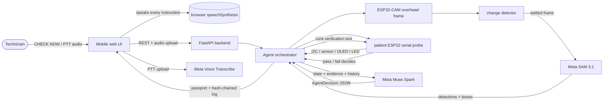

# FundiLoop — verifiable assembly & diagnostic agent for embedded hardware

FundiLoop guides a technician by voice, watches the real circuit with an
overhead camera, verifies every step with real electrical measurements, and
only declares success when a sensor test passes. It is not a chatbot, not a
RAG app, and not a simple image analyzer.

Target circuit (the only one the MVP supports): ESP32 DevKit + BME280 (I2C
0x76/0x77) + SSD1306 OLED (I2C 0x3C) + LED on GPIO 2.

## Repo layout

- `backend/app/` — FastAPI app + orchestrator (`main.py`, `agent_orchestrator.py`,
  `circuit_graph.py`, `serial_probe.py`, `camera_client.py`, `change_detector.py`,
  `models.py`, `adapters/`)
- `backend/data/circuit_esp32_bme280_oled.yaml` — 8 assembly steps, LED wiring, faults
- `backend/requirements.txt` — Python deps
- `firmware/patient_board/patient_board.ino` — patient ESP32 firmware
  (`PING`, `I2C_SCAN`, `READ_SENSOR`, `SELFTEST` over USB serial as JSON lines)
- `frontend/` — mobile web UI served at `/` (plain HTML/JS, no framework)
- `.env.example` — config template (`CAMERA_FRAME_URL`, `SERIAL_PORT`, Meta keys)
- Legacy Day-1 files (`backend/main.py`, `backend/static/`, `esp32/`,
  `CameraWebServer_fundiloop/`) are kept for reference; the app runs from
  `backend/app/` + `frontend/`.
- `scripts/e2e_mock_demo.py` — mock-mode rehearsal: full guided run +
  SDA_SCL_SWAPPED diagnostic run.

## Architecture



The loop is Sense → Reason → Instruct → Verify. Muse proposes; the
orchestrator runs each `verification_test` on real measurements and only a
passing sensor result advances a step or ends a session.

## How each Meta tool is used

- **SAM 3.1** (`MetaSAMAdapter`): segments each *settled* overhead frame
  (motion gating avoids per-frame calls) into labeled components with
  bounding boxes, wire count, and wiring notes.
- **Muse Spark** (`MetaClaudeAdapter`): receives circuit state, SAM
  segments, probe readings, ranked faults, recent history, and the optional
  code snippet; returns a validated `AgentDecision` (retried once on bad
  JSON). Advisory only — sensors decide pass/fail.
- **Voice Transcribe** (`MetaVoiceAdapter`): transcribes push-to-talk
  uploads from `POST /api/voice/transcribe`. Transcripts containing
  "done", "fixed", or "moved it" auto-trigger a loop turn. Speech *output*
  is the browser's `speechSynthesis`, with a replay button.

## Supported faults

- `SDA_SCL_SWAPPED` — live board, totally silent I2C bus (or swapped
  `Wire.begin` pins in pasted code).
- `LOOSE_GND` — no serial signs of life, or present-but-dark OLED.
- `CODE_PIN_MISMATCH` — firmware drives a different pin than the graph
  wires (LED or I2C pins).
- `SENSOR_DISCONNECTED` — OLED on the bus but no BME280 at 0x76/0x77.
- `LED_REVERSED` — GPIO toggles, LED stays dark, code pin matches.

## Safety scope

Low-voltage DC circuits only: USB-powered ESP32 logic at 3V3 (5V-tolerant
wiring errors are still bugs, not hazards). No mains voltage, no
high-current loads, no battery charging, no unattended operation. The LED
loop is current-limited (220 ohm series resistor). If anything smells hot
or the regulator overheats, unplug USB immediately — the agent cannot see
that; you are the safety interlock.

## Setup

1. Python 3.11+ with the project venv (or `python -m venv .venv`):
   `backend\.venv\Scripts\python.exe -m pip install -r backend\requirements.txt`
2. `copy .env.example .env` — defaults run the full loop offline in mock mode
   (`MOCK_META=true`, no keys needed).
3. For real hardware, set in `.env`: `CAMERA_FRAME_URL` (e.g.
   `http://fundiloop.local/capture`), `SERIAL_PORT` (e.g. `COM3`),
   `MOCK_META=false`, plus `META_API_KEY` when wiring real Meta calls.

Patient board: flash `firmware/patient_board/patient_board.ino` with the
Arduino ESP32 core + Adafruit BME280 / SSD1306 / GFX libraries. The
overhead ESP32-CAM is pre-existing — set its still URL in `.env`, no
camera firmware in this repo.

## Run

From the repo root:

```
backend\.venv\Scripts\python.exe -m uvicorn backend.app.main:app --host 0.0.0.0 --port 8000
```

Open `http://<laptop-ip>:8000` on your phone (same Wi-Fi), or
`http://localhost:8000` on the laptop.

API: `GET /api/status`, `POST /api/session/start`,
`POST /api/session/check-now`, `GET /api/camera/latest`.

## Test the mock loop (no hardware, no keys)

Maintained suites (run first, socket-free):
`backend\.venv\Scripts\python.exe -m unittest backend.tests.test_guided_assembly backend.tests.test_diagnostic -v`

1. Start the server, open the page. Mode: Guided Assembly, step 1 instruction
   shown and spoken.
2. Press CHECK NOW (or push-to-talk and say "done") 8 times — each turn
   captures a settled frame, runs SAM + the step's serial verification test,
   and advances on pass; the checklist fills with PASS and an Assembly
   Passport appears.
3. Inject a fault: Advanced → Simulate fault → `SENSOR_DISCONNECTED` → CHECK
   NOW stays on the step with a corrective instruction grounded in the
   measured evidence. Set back to none → CHECK NOW verifies the fix.
4. Diagnostic mode: toggle Diagnostic (captures a SELFTEST + I2C + camera
   baseline), optionally paste Arduino code, inject `LED_REVERSED` + paste
   `#define LED_PIN 4` → CHECK NOW ranks all 5 faults by evidence and
   reports `CODE_PIN_MISMATCH`. Fix one thing per turn; if a re-test
   disproves the hypothesis it moves to the next ranked fault. It ends only
   when READ_SENSOR and CHECK_OLED pass with no fault outstanding, issuing
   a Repair Passport with before/after evidence.
5. Camera: `GET /api/camera/latest` returns a synthetic bench frame until
   `CAMERA_FRAME_URL` is set.
6. Every attempt is logged to `backend/logs/attempts.jsonl` and counted on
   the Passport.

## 3-minute demo script

Rehearse offline first: `python scripts/e2e_mock_demo.py` (full guided run
+ SDA_SCL_SWAPPED diagnostic, hash chains verified).

1. **0:00 — Start.** Server up, page open on the phone. "FundiLoop guides
   a build and proves each step with live measurements."
2. **0:20 — Hands-free assembly.** Do a real wiring step on camera, hold
   PUSH TO TALK, say **"done"**. Transcript appears, the turn runs, the
   step passes, the next instruction is spoken. Hit REPLAY once to show it.
3. **1:10 — Fault + correction.** Pull the BME280 SDA wire (or pick a fault
   in Advanced). Say "done": FAULT_FOUND names the fault with measured
   evidence. Reseat, say "fixed": the re-test verifies the fix.
4. **2:00 — Diagnostic.** Toggle Diagnostic, inject `SDA_SCL_SWAPPED`,
   CHECK NOW: ranked fault list, one guided fix, clear, verify → Repair
   Passport.
5. **2:40 — Proof.** Open `GET /api/session/<id>/passport` (id is in any
   response): full hash-chained log, `chain_valid: true`.
6. **Safety net.** DEMO MODE stays ON: any camera/API failure falls back
   to mocks with a FALLBACK badge instead of crashing. CHECK NOW is pinned
   on screen throughout as the voice fallback.

## Rule the code enforces

Muse never declares success alone: `agent_orchestrator.py` runs every
`verification_test` itself via the SAM adapter + serial probe, and only a
passing measurement advances the step or completes the session.

## Real Meta API mode

Mocks are the default. For live calls, set in `.env`:

```
MOCK_META=false
META_API_KEY=<key>
META_API_BASE_URL=https://api.meta.ai/v1   # Muse chat + SAM vision base
META_API_TIMEOUT=30
MUSE_MODEL=muse-spark-1.3
SAM_MODEL=sam-3.1
VOICE_MODEL=meta-voice-1
# META_ASR_URL=                            # override only; default is base + /asr/transcribe
```

Call shapes mirror the legacy clients (`backend/muse_client.py`,
`backend/sam_client.py`, `backend/transcribe.py`): OpenAI-compatible chat
for Muse/SAM, multipart POST for voice. Muse output is forced to JSON,
validated into `AgentDecision`, and retried once; SAM boxes are parsed to
`{label, box, confidence}` detections.

Failure behavior: any API error, timeout, or unparseable reply raises
`MetaAPIError`, which the orchestrator converts into a safe fallback
instruction ("press Check Now to retry") — the session never crashes, and
serial-probe verification still runs so the sensors keep deciding.

Voice: speech output is always the browser's `speechSynthesis`. Speech
input prefers the browser's speech recognition; where unavailable and live
voice is configured, push-to-talk records and uploads to
`POST /api/voice/transcribe` for Muse Voice Transcribe (WAV conversion via
pydub/ffmpeg when available, raw upload otherwise).
