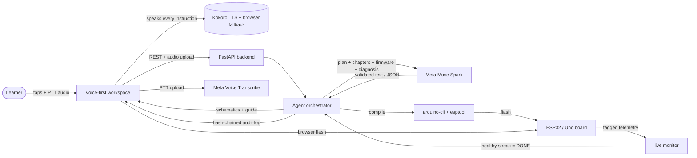

# FundiLoop — verifiable assembly & diagnostic agent for embedded hardware

FundiLoop teaches you to build electronics by voice: it plans your
project, guides each wiring step with diagrams and spoken instructions,
generates and flashes the firmware, and only declares success when live
telemetry from the real board proves it works. It is not a chatbot, not a
RAG app, and not a simple image analyzer.

Current focus is **Learning mode** (board-general — ESP32 DevKit and
Arduino Uno, tap-paced, telemetry-proven). An additional camera-verified
layer adds live overhead vision on top (see below).

## Repo layout

- `backend/app/` — FastAPI app + orchestrator (`main.py`, `agent_orchestrator.py`,
  `learning.py`, `telemetry.py`, `schematic.py`, `breadboard_schematic.py`,
  `visual_schematic.py`, `firmware_build.py`, `firmware_flash.py`, `coach.py`,
  `discovery.py`, `models.py`, `adapters/`)
- `backend/data/circuit_esp32_bme280_oled.yaml` — 8 assembly steps, LED wiring, faults
- `backend/requirements.txt` — Python deps
- `firmware/patient_board/patient_board.ino` — patient ESP32 firmware
  (`PING`, `I2C_SCAN`, `READ_SENSOR`, `SELFTEST` over USB serial as JSON lines)
- `frontend/` — web UI served at `/` (plain HTML/JS, no framework)
- `.env.example` — config template (`SERIAL_PORT`, Meta keys, TTS + coach +
  toolchain settings; `CAMERA_*` keys feed the additional camera feature)
- Legacy Day-1 files (`backend/main.py`, `backend/static/`, `esp32/`,
  `CameraWebServer_fundiloop/`) are kept for reference; the app runs from
  `backend/app/` + `frontend/`.
- `scripts/e2e_mock_demo.py` — mock-mode rehearsal of the additional guided /
  diagnostic run.

## Architecture



The loop is Plan → Wire → Deploy → Prove. Muse proposes (plans,
chapters, firmware, diagnoses); the orchestrator enforces the contracts
(telemetry-shaped firmware, tagged serial proof) and only a healthy
telemetry streak from the real board marks a build DONE.

## UI

Voice-first workspace with a dark design: a top bar, a left guide panel,
and a right stage.

- **Top bar** — logo + MOCK/LIVE badge, stage tabs
  (Diagram / Breadboard / Code), wake-word toggle, settings.
- **Guide panel (left)** — hero with the mesh orb on the home screen
  (canvas wireframe globe: idle breath, cyan while listening, purple/pink
  while speaking, amber while planning); ideation box (project prompt +
  board picker + parts-photo upload + project cards); then the learning
  leaf once a session starts (mini orb, step counter, progress bar,
  instruction bubble, wire-by-wire guide, parts chips, ask-the-coach box,
  hands-free toggle).
- **Stage (right)** — Diagram tab (pin-cards schematic SVG with zoom,
  Speak wires, SVG download), Breadboard tab (breadboard wiring view),
  Code tab (firmware viewer with Copy / Send to Board).
- **Coach bar** — thin bottom strip with the single primary action
  (Next / Deploy / ...) plus talk, mute, and overflow (Repeat, Look).
- **Deploy bar** — port picker, Connect, Deploy, live progress.
- **Drawers** — CODE drawer (build panel: firmware, schematic, server +
  browser flash, fix-it, what's next, coach log) and MONITOR drawer
  (live serial monitor with port pick + start/stop).
- **Flash dialog** — modal console with live log lines and progress
  during server flashes (streamed over SSE).

## How each Meta tool is used

- **SAM 3.1** (`MetaSAMAdapter`): grounds part regions in uploaded photos —
  one call per part prompt (plus jumper wire + breadboard), overlapped 8 at
  a time — returning labeled boxes + confidences for the scene reading.
- **Muse Spark** (`MetaClaudeAdapter`): reads each uploaded photo (a 448px
  still plus the SAM regions) into structured scene JSON — visible parts,
  connections, uncertainties; plans projects; writes teach-style chapters;
  generates the Arduino firmware; and diagnoses stalled telemetry streams.
  JSON callers validate and retry once on bad output; firmware codegen runs
  as plain text with its own longer timeout. Advisory only — telemetry
  decides pass/fail.
- **Voice Transcribe** (`MetaVoiceAdapter`): transcribes push-to-talk
  uploads from `POST /api/voice/transcribe`. Transcripts containing
  "done", "next", "move on", "finish", "complete", or "ready" advance the
  step; anything else goes to the coach as a question.
- **Voice TTS** (`backend/app/tts.py` + frontend `VoiceEngine`): every
  utterance tries `POST /api/voice/speak` (Kokoro local neural TTS,
  `af_heart` American female default) first and falls back to default
  browser `speechSynthesis` for that utterance only on failure.

## Learning mode flow

Tap-paced, telemetry-proven — no per-step sensor gate:

1. **Ideate** — name the build, pick the board (ESP32/UNO), optionally
   upload a parts photo; the planner returns a project (requested builds
   plan exactly as asked).
2. **Wire** — tap Next through the steps at your own pace. The schematic
   highlights the current step's wires; karaoke wire speech lights each
   wire exactly as it is named.
3. **Firmware warms in the background** — after session start and every
   step advance, the server pre-generates the session firmware off the
   request path, so the Code tab and Deploy are instant when opened.
   Failures stay silent here; the on-demand fetch retries honestly.
4. **Deploy** — the Deploy bar unlocks at the final step. Deploy uses the
   browser Web Serial port when connected, else server-side esptool over
   SSE (firmware generates live inside the stream, so the dialog fills
   immediately instead of sitting empty).
5. **Telemetry proof** — firmware must print one tagged line per device
   (`DEVICE | METRIC | VALUE | UNIT`, e.g. `HC-SR04 | DIST | 45.0 | cm`)
   plus a `SYS | HEARTBEAT | OK | -` line every loop. A healthy streak in
   the monitor marks the build DONE. A stall triggers a model diagnosis
   naming the suspect wire (healthy devices exonerate shared power/ground)
   with a rescue card; `MARK COMPLETE ANYWAY` is the escape hatch.

## Schematic + ESP32 flash

Each learning step shows its wiring on the stage via a progressive SVG
schematic (`GET /project/{id}/step/{n}/schematic`): pin-cards Diagram tab
plus a Breadboard wiring view, current-step wires bright, earlier ones
dimmed. The schematic animates wire-by-wire as the tutor speaks — each
wire lights up when its name is spoken (word-boundary driven on browser
speech, chunk-driven on server TTS), with hover tooltips, click-to-isolate,
zoom, Speak wires, and SVG download.

One-tap flashing via server esptool (Deploy bar / FLASH FINAL, SSE log +
progress) or browser Web Serial (Connect + Deploy, Chrome/Edge). Both
share one busy guard; checks and flashes block each other with a retap
prompt instead of dead-ending. Server flashes are audit-logged to
`backend/logs/coach_audit.jsonl`.

## Additional feature — live camera verification

On top of the core Learning flow, an additional camera-verified layer
watches the bench live:

- ESP32-CAM overhead frames + motion-gated change detection, so vision
  runs on settled frames only (`camera_client.py`, `change_detector.py`).
- Per-turn sense pass: settled frame + SAM regions + serial probe merged
  before every Muse decision.
- Guided Assembly / Diagnostic sensor-verified flows, including the fault
  library (`SDA_SCL_SWAPPED`, `LOOSE_GND`, `CODE_PIN_MISMATCH`,
  `SENSOR_DISCONNECTED`, `LED_REVERSED`).

## Safety scope

Low-voltage DC circuits only: USB-powered ESP32 logic at 3V3. No mains
voltage, no high-current loads, no battery charging, no unattended operation.
If anything smells hot or the regulator overheats, unplug USB immediately —
the agent cannot see that; you are the safety interlock.

## Setup

1. Python 3.11+ with the project venv:
   `backend\.venv\Scripts\python.exe -m pip install -r backend\requirements.txt`
2. `copy .env.example .env` — defaults run the full loop offline in mock mode
   (`MOCK_META=true`, no keys needed).
3. For real hardware, set in `.env`: `SERIAL_PORT`, `MOCK_META=false`,
   `META_API_KEY`.
4. For Kokoro TTS (recommended, works offline):
   `pip install -r backend/requirements-kokoro.txt`, download
   `kokoro-v1.0.onnx` + `voices-v1.0.bin` into `backend/data/kokoro/`,
   set `TTS_PROVIDER=kokoro`. Install eSpeak-NG if synthesis warns:
   `winget install eSpeak-NG.eSpeak-NG`.

Patient board: flash `firmware/patient_board/patient_board.ino` with the
Arduino ESP32 core + Adafruit BME280 / SSD1306 / GFX libraries.

## Run

```
backend\.venv\Scripts\python.exe -m uvicorn backend.app.main:app --host 0.0.0.0 --port 8000
```

Open `http://<laptop-ip>:8000` on your phone (same Wi-Fi), or
`http://localhost:8000` on the laptop.

## Learning mode toolchain (ESP32 flash)

One-time install on the laptop (offline after):

1. `pip install -r backend/requirements.txt` (includes `esptool`).
2. Install `arduino-cli`, then `arduino-cli core install esp32:esp32`.
   Sketch libraries auto-install at first build; to pre-seed:
   `arduino-cli lib install "Adafruit GFX Library" "Adafruit SSD1306" "Adafruit BME280 Library" "Adafruit Unified Sensor"`.
3. Set paths in `.env` if non-default: `ARDUINO_CLI_BIN`, `ARDUINO_FQBN`,
   `ESPTOOL_BIN` (see `.env.example`).

## Test the mock loop

```
backend\.venv\Scripts\python.exe -m unittest backend.tests.test_frontend_regressions backend.tests.test_telemetry backend.tests.test_project_code backend.tests.test_discovery -v
```

Or run the full suite (660+ tests):
```
backend\.venv\Scripts\python.exe -m unittest discover -s backend/tests -v
```

Frontend: `node frontend/test_karaoke.js` (25 checks, no server needed).

## Rule the code enforces

Muse never declares success alone: the learner taps through steps at their
own pace, but DONE still requires a healthy telemetry streak from the real
board — never the model's word alone.

## Discovery layer

There is no fixed project catalog. Discovery is generative:

- `POST /discover/upload` saves an equipment photo (no camera needed);
  `POST /discover/parts` reports what is visible in it via
  `understand_scene`: SAM grounds the regions, Muse reads the still into
  structured JSON, and Python cross-checks every named part against a SAM
  box (0.6 confidence bar; failures land in `uncertainties`, never raise).
- `POST /discover/projects` returns model-generated build plans, each step
  mapped to a real verification test.
- The `AVAILABLE_TESTS` registry (`backend/app/capabilities.py`) lists the
  only tests plans may use: `RUN_I2C_SCAN`, `READ_SENSOR`, `CHECK_OLED`,
  `CHECK_GPIO`, `CHECK_SERIAL`.
- Every plan step must map to a real test (bad names are rejected and
  retried once). A user-requested build is planned exactly as asked —
  the bench never gates what the user asked to build.

## Real Meta API mode

Mocks are the default. For live calls set in `.env`:

```
MOCK_META=false
META_API_KEY=<key>
META_API_BASE_URL=https://api.meta.ai/v1
MUSE_MODEL=muse-spark-1.3
SAM_MODEL=sam-3.1
VOICE_MODEL=meta-voice-1
TTS_PROVIDER=kokoro
KOKORO_VOICE=af_heart
```

Failure behavior: any API error, timeout, or unparseable reply raises,
the API returns HTTP 502 with the real error text, and the step stops.
Nothing is replaced with mock data.
